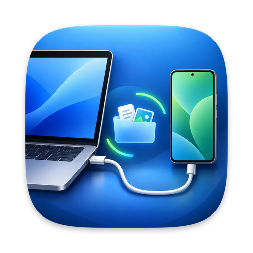
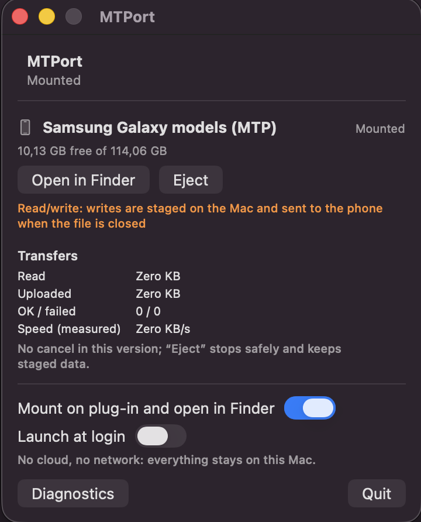
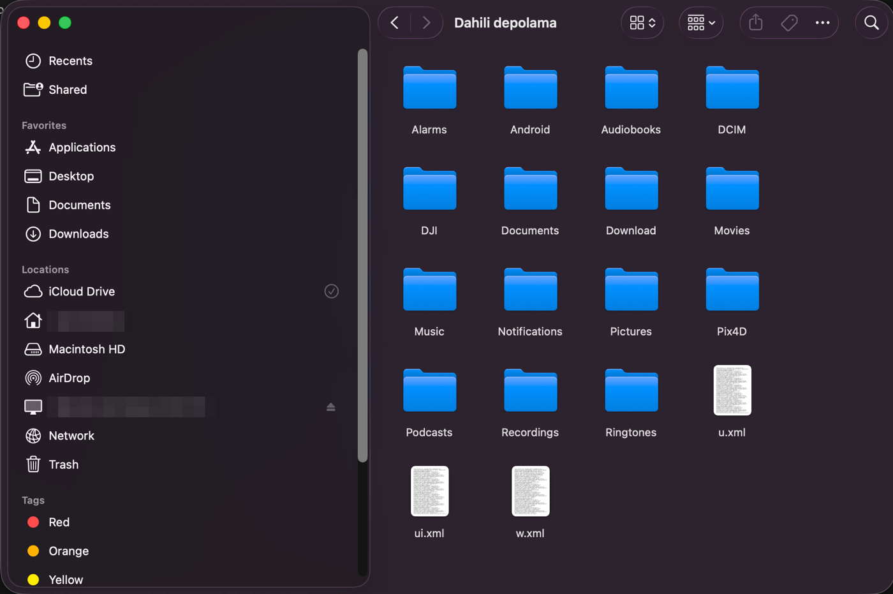

<p align="center"></p>

# MTPort

**Android telefonun Finder'da normal bir disk gibi görünsün.** Kabloyu tak: telefon Finder kenar çubuğunda kendi adıyla,
çıkarma (eject) düğmesiyle birlikte belirir. Android File Transfer penceresi, ADB, telefona kurulan uygulama, bulut,
root ya da kernel uzantısı yok.

[English README](README.md) · [Sorun giderme](docs/TROUBLESHOOTING.tr.md) · [Veri güvenliği](docs/DATA_SAFETY.md) ·
[Değişiklikler](CHANGELOG.md)

> **Durum: geliştirici önizlemesi (v0.1.0).** İmzalı/notarize değil, bu yüzden kendin derlersin (aşağıda tek komut).
> Kaybetmek istemediğin dosyalara güvenmeden önce [Neler desteklenmiyor](#neler-desteklenmiyor) bölümünü oku.

## Ekran görüntüleri

<table>
<tr>
<td align="center" valign="top" width="34%"><br><sub>MTPort penceresi: durum, kapasite, <i>Finder'da Aç</i> / <i>Çıkar</i>, aktarımlar.</sub></td>
<td align="center" valign="top" width="66%"><br><sub>Telefon Finder kenar çubuğunda (<i>Konumlar</i> altında, çıkarma düğmesiyle) ve depolaması normal bir Finder penceresinde açık.</sub></td>
</tr>
</table>

## Ne yapar

* **USB "Dosya aktarımı (MTP)"** modundaki telefonu algılar, bağlar ve Finder'da açar. Kabloyu çıkarıp taktığında yeniden
  bağlar.
* Klasörlere göz at, telefondan fotoğraf/video/dosya kopyala, telefona **yeni** dosya kopyala. Finder'dan ya da
  Terminal'den.
* Menü çubuğu öğesi ve küçük bir pencere: telefonun durumu, kapasitesi, aktarımlar, *Bağla*, *Finder'da Aç*, *Çıkar*.
* Büyük klasörler (yaklaşık 1800 fotoğraf) birkaç saniyede açılır, tekrar açılışlar anında olur.
* Her şey Mac'inde kalır: macOS'un kendisine yapılan bir yerel (loopback) bağlantı dışında ağ erişimi yok
  ([Nasıl çalışır](#nasıl-çalışır)).

## Neler desteklenmiyor

MTP bir *nesne* protokolü, disk değil. Bu yüzden birkaç şey USB bellekten farklı çalışır. Aşağıdaki sınırlar verini
korumak için bilerek konmuştur:

| Çalışır | **Çalışmaz** (açık bir hata verir) |
|---|---|
| Gezinme, önizleme (Quick Look), telefondan dosya kopyalama | Telefonda zaten var olan bir dosyanın üzerine yazma |
| Telefona **yeni** dosya ve klasör kopyalama | Telefondaki dosyayı yerinde düzenleme (bir editörde "kaydet") |
| Klasör oluşturma; aynı klasör içinde yeniden adlandırma | Klasörler / depolar arası taşıma (kopyala, sonra sil) |
| Dosyayı ya da boş klasörü silme | Dolu bir klasörü tek hamlede silme |
| Çıkarma, kabloyu çıkarıp yeniden takma | Telefonda Spotlight araması (dizinleme kapalı) |

Bunları da bil:

* **Genel olarak Android telefonlarla çalışır.** MTPort, Android'in USB dosya aktarımı için kullandığı standart protokol
  olan MTP'yi konuşur. Yapman gereken tek şey, kabloyu taktığında telefonun USB bildiriminde **Dosya aktarımı**'nı
  seçmek; sonrasında sorunsuz çalışır. Telefonun farklı davranırsa lütfen bir issue aç
  ([docs/DEVICE_COMPATIBILITY.md](docs/DEVICE_COMPATIBILITY.md) şimdiye kadar nelerin kontrol edildiğini listeler).
* Hızı MTPort değil telefonun USB bağlantısı belirler: USB 2.0 "High Speed" bağlantıda yaklaşık 17–33 MB/sn, telefon
  "Full Speed" pazarlık ederse ~1 MB/sn. Yapay bir hız sınırı yok.
* **Çok büyük** bir dosyanın (ör. 1,6 GB video) sonu, macOS o kadar indirmişse okunabilir; bu yüzden böyle bir videoyu
  önizlemek yaklaşık bir dakika sürebilir. Bkz. [Sorun giderme](docs/TROUBLESHOOTING.tr.md#büyük-videolar-geç-açılıyor).
* Telefon bağlıyken Mac'in uykuya geçip uyanması donanımda test edilmedi.

## Gereksinimler

* **macOS 15.4 veya üstü** bir Mac (macOS 26 / Apple Silicon üzerinde test edildi; Intel test edilmedi).
* **Xcode** (uygulamayı derlemek için; App Store'daki ücretsiz sürüm yeterli) ve [Homebrew](https://brew.sh).
* Bir Android telefon, **veri aktarabilen** bir USB kablo ve *Dosya aktarımı (MTP)* modunda, kilidi açık telefon.
* macFUSE **gerekmez**. (Yalnızca isteğe bağlı, deneysel bir taşıyıcı kullanır; aşağıya bak.)

## Kurulum

```bash
git clone https://github.com/oguzhanaktas1/MTPort.git
cd MTPort
brew install libmtp libusb cmake ninja pkgconf xcodegen
scripts/install-app.sh
```

`scripts/install-app.sh` yerel araçları ve uygulamayı derler ve **`~/Applications/MTPort.app`** olarak kurar (`sudo`
yok). Birkaç dakika sürer. Neyin eksik olduğunu görmek istersen önce `scripts/bootstrap.sh` çalıştır; yalnızca yazdırır,
hiçbir şey kurmaz.

Kendin derlediğin için macOS uygulamayı karantinaya almaz. Başka bir Mac'ten derlenmiş bir `MTPort.app` kopyalarsan sağ
tık → *Aç* yap ya da `xattr -dr com.apple.quarantine MTPort.app` çalıştır.

## Kullanım

1. **Telefonun kilidini aç.** Bildirim çubuğunu aşağı çek, USB bildirimine dokun ve **Dosya aktarımı (MTP)** seç.
   Telefon *verilere erişime izin* ya da *bu aksesuara izin* sorarsa onayla.
2. **MTPort**'u aç (Dock simgesi ya da menü çubuğu). Açık kalsın; istersen menüsünden *Oturum açılışında başlat* seçeneğini aç.
3. Kabloyu tak. Birkaç saniye sonra telefon Finder'da (kenar çubuğu → *Konumlar*) görünür ve bir Finder penceresi açılır.
   Takmadan sonraki ilk bağlantı, telefon depolamasını hazırlarken bir dakikaya kadar sürebilir.
4. İşin bitince kabloyu çekmeden önce Finder'dan (ya da MTPort'tan) **çıkar**. Çıkardıktan sonra telefon, kabloyu
   çıkarıp tekrar takana kadar (ya da *Bağla*'ya basana kadar) yeniden bağlanmaz.

Kenar çubuğunda görünmüyorsa *Finder → Ayarlar → Kenar Çubuğu → Konumlar → Bağlı sunucular*'ı aç ve
[Sorun giderme](docs/TROUBLESHOOTING.tr.md)'ye bak. Telefonun deposu, telefonun depo adıyla bir klasör olarak görünür
(ör. *Dahili depolama* ya da *Internal storage*).

### Komut satırı

Aynı motor `mtport` olarak da kullanılabilir (derleme çıktısı: `build/native/cli/mtport`):

```bash
mtport doctor                      # bu Mac'te neler çalışıyor, neler eksik
mtport devices                     # bağlı MTP telefonlar
mtport info                        # depolar ve yetenekler
mtport ls   --path /DCIM           # klasör listele (yollar telefonun deposunun içindedir)
mtport pull --src /DCIM/Camera/IMG.jpg --dst ~/Desktop/IMG.jpg      # SHA-256 yazdırır
mtport push --src ~/Desktop/test.bin --dst /Download/test.bin --verify
mtport mount [--read-write]        # uygulamasız bağla (--read-write yoksa salt-okunur)
mtport unmount
mtport status
```

`push`, `mkdir` ve `mv` var olan bir nesnenin yerine asla yazmaz; `rm` tam olarak bir nesneyi siler (klasörse yalnızca boşsa).

## Nasıl çalışır

```
MTPort.app (SwiftUI, menü çubuğu + pencere)
   │  özel bir Unix soketi üzerinden JSON
mtport-agent ── USB'yi izler, her telefon için bir işçi başlatır
   │
mtport-mount (telefon başına bir tane)
   ├─ tek MTP oturumuna sahiptir (libmtp / libusb), her şeyi sıraya koyar
   ├─ dosya sistemi katmanı: önbellek, Mac'te yazma hazırlığı, güvenlik kuralları
   └─ 127.0.0.1 üzerinde küçük bir WebDAV sunucusu (rastgele port, rastgele parola)
         │
   macOS ağ birimi desteği (NetFS)  →  /Volumes/MTPort-<model>  →  Finder
```

* Telefon, *Finder → Sunucuya Bağlan* ile aynı yolla bağlanır; yani gerçek bir ağ birimidir: kenar çubuğunda görünür,
  çıkarma düğmesi vardır, kernel uzantısı, macFUSE ya da yönetici parolası gerekmez.
* Kenar çubuğu girdisi **telefonun kendi adını** taşır. macOS, bağlantı adresinin sunucu adını gösterir; işçi bu adı
  sistemin mDNS servisi üzerinden yalnızca yerel adres (`127.0.0.1`) için yayınlar. Kendi Mac'inden başkası kullanamaz.
* Telefona kopyaladığın dosyalar önce Mac'te özel bir hazırlık alanına yazılır, dosya kapanınca gönderilir. Yükleme
  başarısız olursa hazırlanan baytlar saklanır (`~/Library/Caches/MTPort/Staging`), sessizce silinmez.
* Finder'ın yardımcı dosyaları (`.DS_Store`, `._*`) yalnızca bellekte tutulur, telefona yazılmaz.

Deneysel bir alternatif olan `mtport mount --transport fskit`, macFUSE 5.4+ ve FSKit arka ucunu kullanır. macFUSE
birimleri Finder kenar çubuğunda listelenmediği için varsayılan değildir. Ayrıntı: [docs/DEVELOPMENT.md](docs/DEVELOPMENT.md).

## Sorun giderme (kısa)

| Belirti | Dene |
|---|---|
| Telefon listede ama klasör boş, ya da "Operation not permitted", ya da uygulama *Telefon algılandı: Dosya aktarımını seçin* ya da *Bağlanıyor…* durumunda takılı kalıyor | Telefonun kilidini aç, **Dosya aktarımı (MTP)** seç, *erişime izin ver* uyarısını onayla, ekran açıkken kabloyu çıkarıp tak |
| Finder'da hiçbir şey görünmüyor | MTPort çalışıyor mu? *Finder → Ayarlar → Kenar Çubuğu → Bağlı sunucular* açık mı? `mtport doctor` ve `mtport status` çalıştır |
| `DeviceBusy: could not open an MTP session` | Android File Transfer, OpenMTP, MacDroid, Görüntü Yakalama, Fotoğraflar'ı kapat; kabloyu yeniden tak |
| `libusb_open() failed … Operation timed out`, telefon USB'den kayboluyor | Kabloyu yeniden tak (başka port/kablo dene) |
| Bir dosyanın üzerine kaydederken "Operation not supported" | Bilerek: MTP yerinde düzenleme yapamaz. Bunun yerine yeni bir dosya kopyala |

Nedenleri ve çözümleriyle tam liste: **[docs/TROUBLESHOOTING.tr.md](docs/TROUBLESHOOTING.tr.md)**.

## Kaldırma

```bash
osascript -e 'tell application "MTPort" to quit'
rm -rf ~/Applications/MTPort.app
ls ~/Library/Caches/MTPort/Staging        # burada kalan her şey telefona ulaşmamış bir yüklemedir
rm -rf ~/Library/Application\ Support/MTPort ~/Library/Caches/MTPort
```

## Proje yapısı

| Yol | Ne |
|---|---|
| `native/core` | MTP cihaz arayüzü, tipli hatalar, `libmtp` arka ucu, tek-sahip kilidi |
| `native/filesystem` | MTP-POSIX eşlemesi, önbellekler, yazma hazırlığı, güvenlik kuralları |
| `native/webdav` | yerel WebDAV sunucusu ve macOS bağlama çağrısı |
| `native/fuse` | deneysel macFUSE bağdaştırıcısı |
| `native/mount`, `native/agent`, `native/cli` | `mtport-mount`, `mtport-agent`, `mtport` |
| `macos/MTPort` | SwiftUI uygulaması (proje `xcodegen` ile üretilir) |
| `tests` | sahte telefonla birim/entegrasyon testleri ve gerçek telefon kontrol betikleri |

Derleme ve test için [docs/DEVELOPMENT.md](docs/DEVELOPMENT.md), katkı için [CONTRIBUTING.md](CONTRIBUTING.md). En
değerli katkı: **kendi telefonunda dene ve sonucu bildir** ([docs/HARDWARE_ACCEPTANCE.md](docs/HARDWARE_ACCEPTANCE.md)).

## Lisans

[MIT](LICENSE). MTPort, `libmtp` ve `libusb`'ye (LGPL-2.1+) dinamik olarak bağlanır, kodlarını kopyalamaz; bkz.
[third_party/NOTICES.md](third_party/NOTICES.md). "Android", Google LLC'nin ticari markasıdır; bu proje Google, Samsung
ya da Apple ile bağlantılı değildir ve onlar tarafından onaylanmamıştır.
